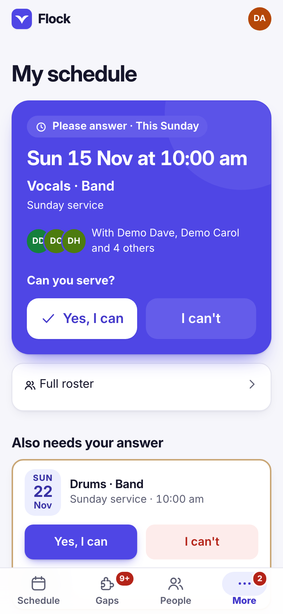
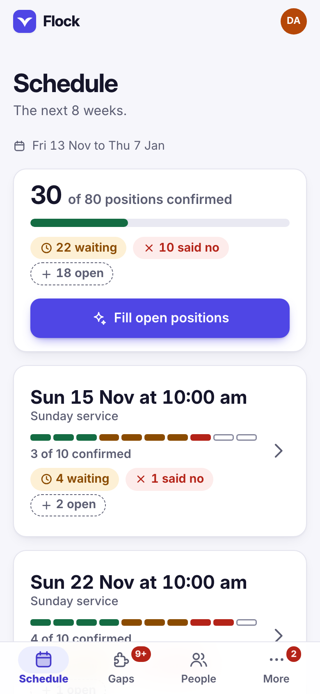
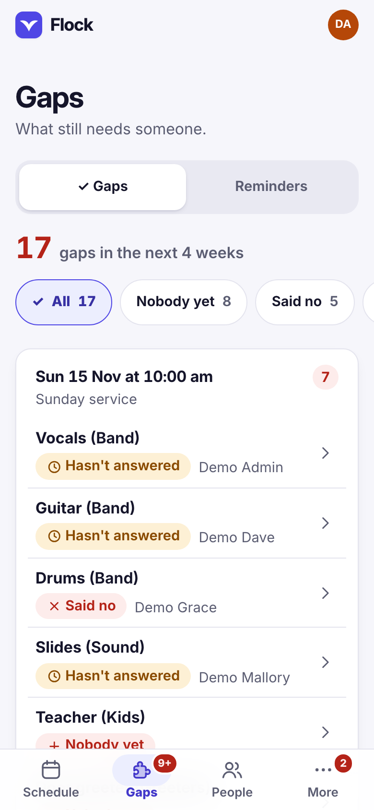

# Flock

Flock helps a church plan who serves on which Sunday. A scheduler puts people
in positions on the church's teams (band, sound, kids, greeters and so on), and
volunteers open Flock on their phones to see when they are serving, say yes or
no, and mark the days they are away.

Flock is one small program and one database file. It uses no outside services
and sends no emails or texts; if the church turns them on, it can send
notifications to the phones of people who ask for them.

<p align="center">  </p>

*Flock on a phone, with made-up people: a volunteer's schedule, the scheduler's plan, and the gaps still to fill.*

## Quick start

You need [Node.js](https://nodejs.org) 22.16 or newer. In the Flock folder:

```
npm start
node bin/flock.js create-admin pat.smith@example.org 'Pat Smith'
```

Flock runs at `http://localhost:8080`. `create-admin` prints a one-time invite
link: open it and choose a password. To look around with made-up people first,
see [Trying it with fake data](docs/running-flock.md#trying-it-with-fake-data).

## Documentation

The guides are also at <https://romeodemeteriojr.github.io/flock/>.


- [Using Flock](docs/using-flock.md): adding people, logging in, and what each
  page does.
- [Running Flock](docs/running-flock.md): settings, the first scheduler,
  Google sign-in, notifications, backups and exports.
- [Security](docs/security.md): how passwords and logins are kept safe, and
  what a server needs.
- [Design](docs/design.md): the look, the installed app, phone and computer
  layouts, the gallery.
- [Changelog](CHANGELOG.md): what changed in each version.

## What Flock does not do

- It sends no emails or texts. It drafts reminder messages for you to copy
  and send.
- It has no songs, set lists, files or media; it only schedules people.
- There is no app in the app stores; Flock can be added to the Home Screen
  instead.
- It is built for one church of about 70 people.

## For developers

Plain JavaScript for Node.js 22.16 or newer, with no npm packages.

- `npm test` runs every test (made-up people, temporary databases only).
  `npm run coverage` adds Node's coverage report.
- [ARCHITECTURE.md](ARCHITECTURE.md) explains the layers and how they fit.
  [TESTING.md](TESTING.md) and [UAT.md](UAT.md) cover the automatic and the
  by-hand checks. [docs/decisions/](docs/decisions/) records the main design
  decisions.
- `node bin/flock.js help` lists the commands.

## Licence

Flock is free for churches, charities, schools and personal use, under the
[PolyForm Noncommercial License 1.0.0](LICENSE). You may use, change and share
it for any non-commercial purpose. Selling it, or using it for a business, needs
the author's permission: ask through GitHub. The bundled Inter font has its own
licence ([licenses/Inter-OFL.txt](licenses/Inter-OFL.txt)).
