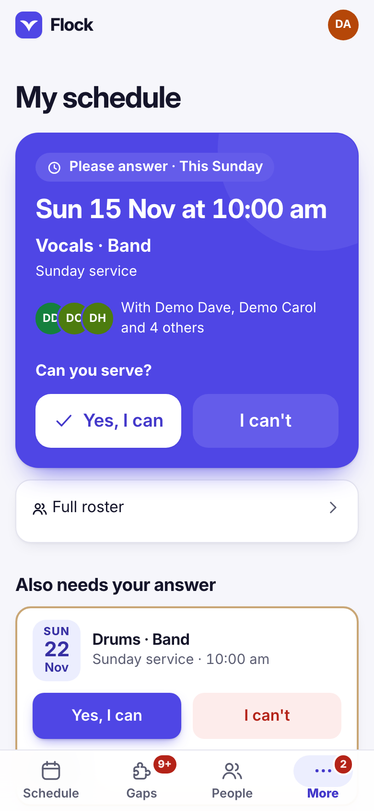
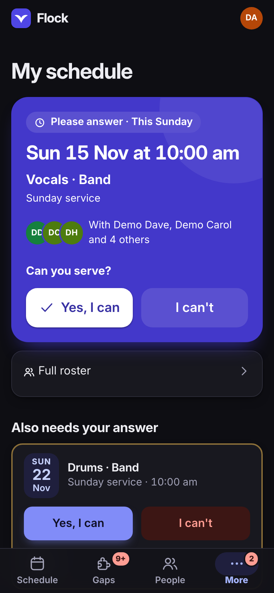
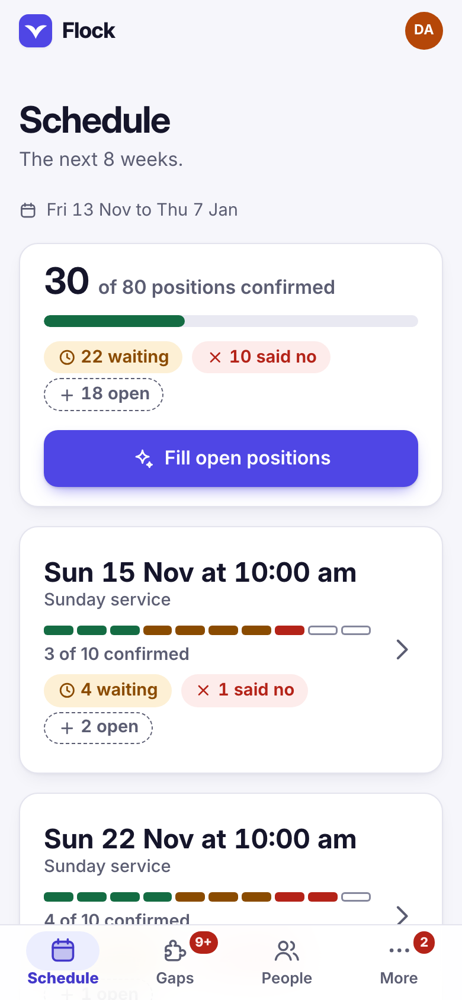
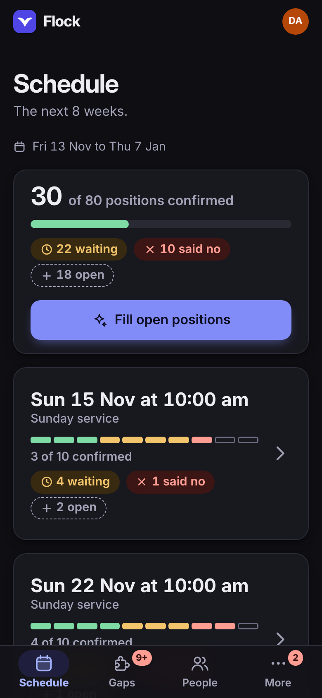
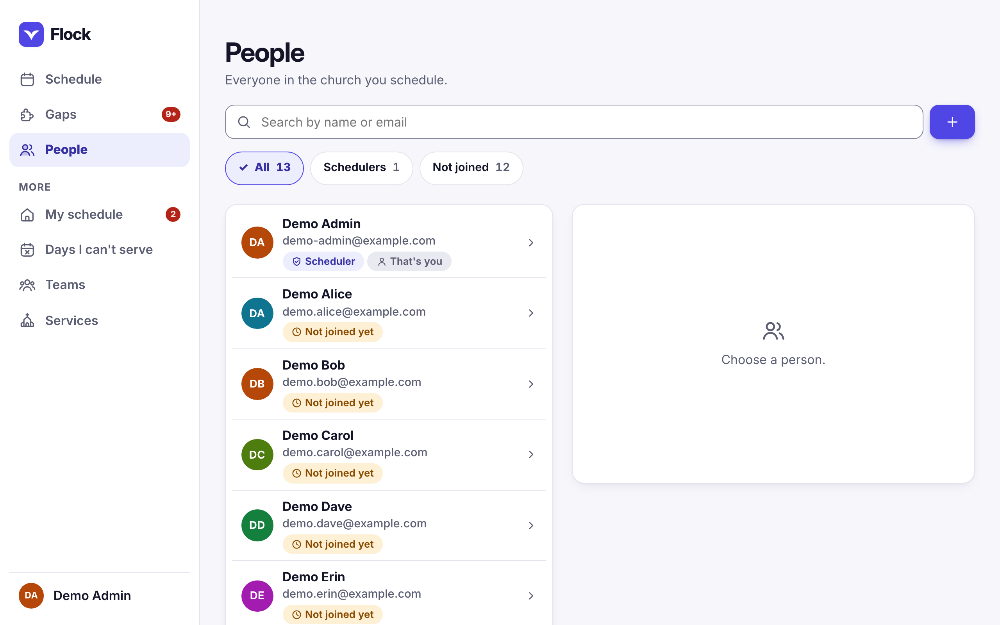

# Design

How Flock looks and behaves, and where to change it.

## The look

Flock has one brand colour (indigo) on soft, slightly tinted greys, in a light
and a dark version. The mark is a white bird on an indigo tile; the same tile
is the app icon on a phone's home screen.

Inter is bundled locally (license: `licenses/Inter-OFL.txt`), cut down to Latin
letters so it loads quickly on a phone: English, accented European letters,
Vietnamese, and Pacific names with macrons or an ʻokina. Names in other
alphabets (Greek or Cyrillic, say) are shown in the phone's own font. No fonts
or other assets are fetched from outside services.

Light and dark, following the device:

 

Every icon is drawn on the same grid, and each page has its own picture in the
menu. Status is never shown by colour alone: every coloured tag also has a
symbol and a word. Touch targets are at least 48px.

Flock follows the device's light or dark setting, and turns off all movement
when the device asks for reduced motion. Printing the Schedule page gives a
plain black-and-white grid.

## On a phone

Flock is used mostly as an installed phone app, and is designed at phone width
first.

- The main pages sit in a tab bar at the bottom; the page you are on has a
  soft pill, a filled-in icon and bold text. The tabs show numbers: the asks
  waiting for your answer on **My schedule** (also on the installed app's
  icon), the gaps on **Gaps**.
- The top bar is slim: the mark, the bell and your initials, which open your
  account (notifications, password, install, log out). Scroll down and the
  page title takes the place of "Flock".
- Sheets come up from the bottom and can be swiped down to close; **More** is
  one of them. Invites and reminders can go straight to the phone's share
  sheet.
- Pages fade in, things you press give a little, and saying yes is thanked
  with a check.

 

## The installed app

Flock can be added to the Home Screen (My schedule offers it, or tap your
initials, then **Install Flock**; on an iPhone it shows the three steps). It
then:

- opens straight away, even while the server is waking up or the signal is
  poor, because the phone keeps a copy of Flock's own files (never your data;
  [decision 0009](decisions/0009-app-shell-cache.md));
- says **Can't reach the server**, with **Try again**, when there is no
  connection at all, and opens by itself when the connection is back;
- updates itself: a new version is fetched in the background and used from
  the next tap that changes the page;
- offers **My schedule** and **Days off** when you press and hold its icon
  (Android, desktop Chrome and Edge).

## On a computer

At 1024 pixels wide and up, the menu becomes a column on the left with your
name at the bottom; your account opens as a small menu above it. People, Gaps
and Schedule show what you picked in a pane beside the list instead of a sheet
over it, and My schedule puts what is coming up beside the next thing.
Tablets (720 to 1023 pixels) keep the phone layout with the menu along the
top.

## Changing it

- **The brand colour:** edit the colour list at the top of `web/style.css`
  (`--brand`, `--accent` and the few colours next to them, once for light and
  once for dark). `npm test` checks that every text and background pair is
  still easy to read.
- **The gallery:** `/gallery.html` (for example
  `http://localhost:8080/gallery.html`) shows every screen and part of the
  design without logging in. It uses made-up names, saves nothing and is not
  linked from the app.
