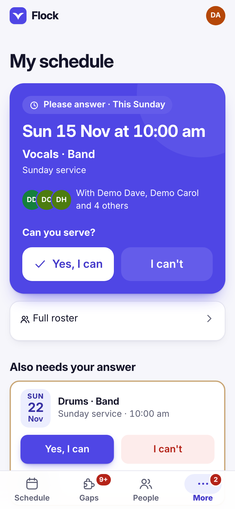
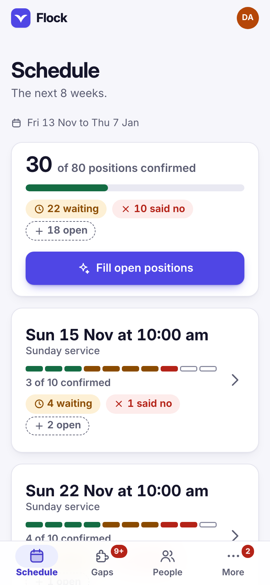
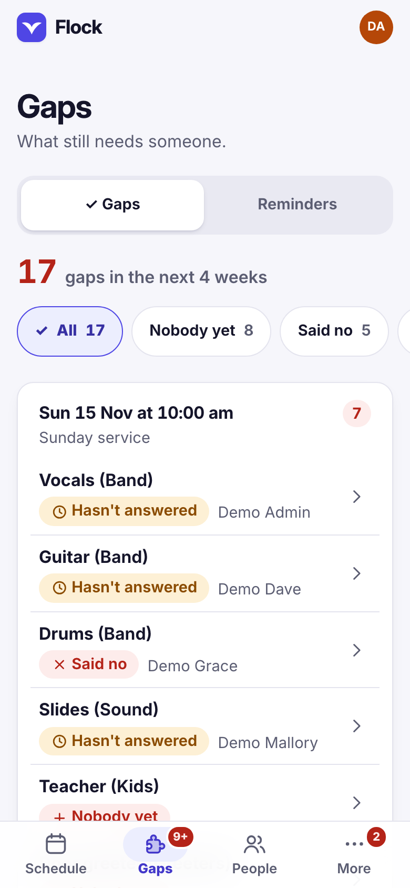

# Flock

Flock helps a church plan who serves on which Sunday. A scheduler puts people in
positions, and volunteers open Flock on their phones to see when they serve, say
yes or no, and mark the days they are away.

  

- [Using Flock](using-flock.md): adding people, logging in, and what each page does.
- [Running Flock](running-flock.md): settings, the first scheduler, notifications, backups.
- [Security](security.md): passwords, logins, and what a server needs.
- [Design](design.md): the look, the installed app, phone and computer layouts.

Code, changelog and licence: [github.com/romeodemeteriojr/flock](https://github.com/romeodemeteriojr/flock).
Free for churches, charities and personal use under the
[PolyForm Noncommercial License 1.0.0](https://github.com/romeodemeteriojr/flock/blob/main/LICENSE).
