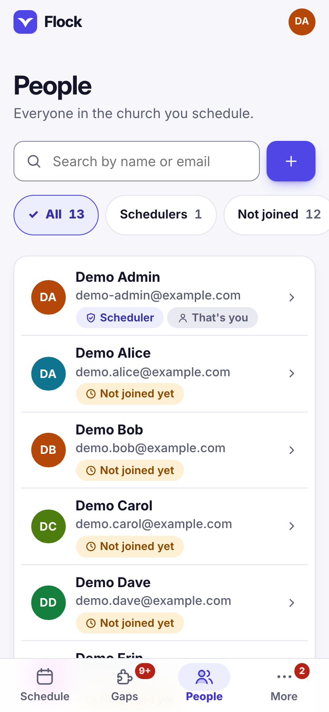
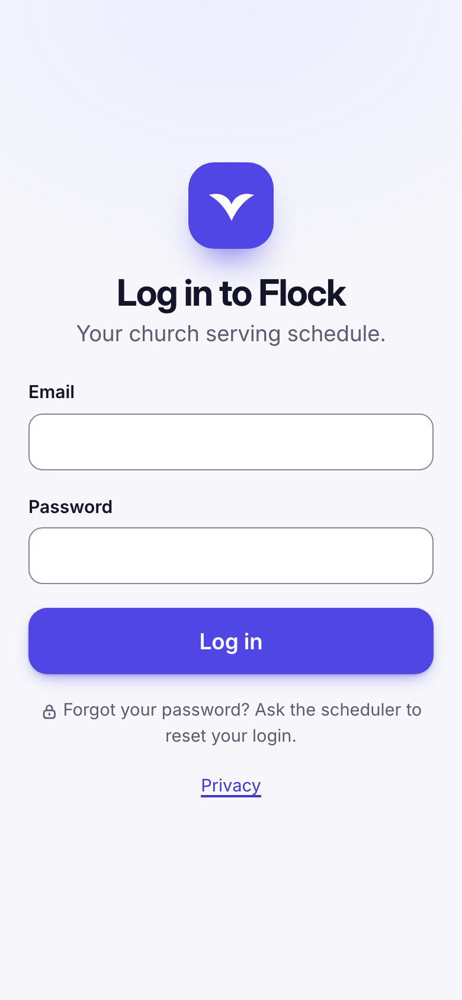
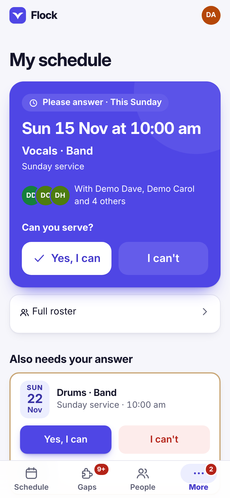
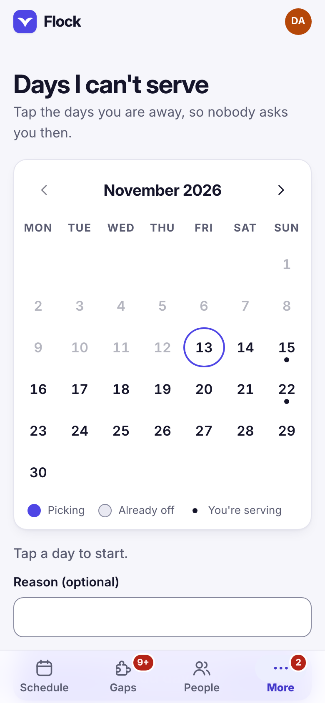
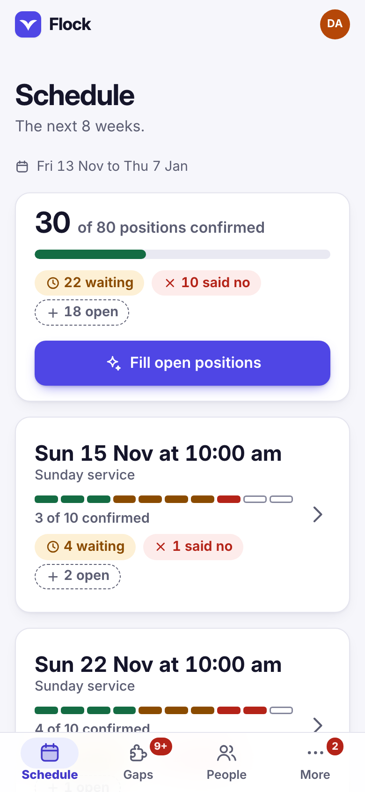
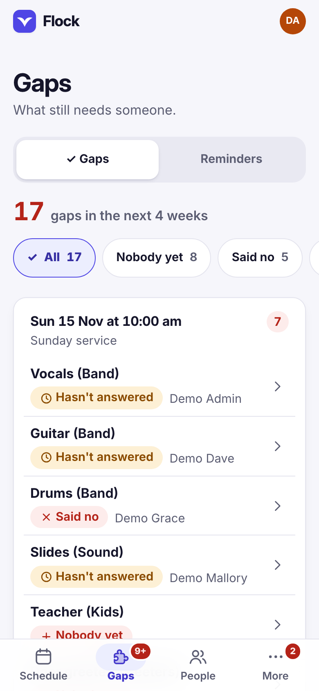
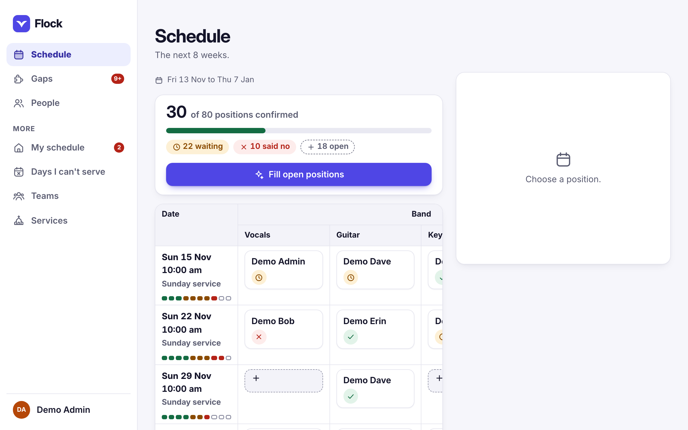

# Using Flock

For schedulers and volunteers. Setting Flock up is in
[Running Flock](running-flock.md).

## Adding people

On **People**, tap the **+** button, enter their name and email, and choose
**Add person**. The email is how
they log in. Saving opens an invite message: choose **Share** (on a phone) or
**Copy message** and send it privately through your usual messages app. The
person taps the link, sees the email they log in with and chooses a password,
which also logs them in. The link works once, for 7 days.

Someone without an email (for example a child or a person who does not use
email) can still be added and scheduled; they just cannot log in.

Tap a person to open their sheet with everything you can do for them:

- **Positions**: mark which positions they can do.
- **Change name**.
- **Make a scheduler** or **Make a volunteer**.
- **Copy new invite** (for someone marked **Not joined yet**): makes a new link
  and cancels their previous one.
- **Reset login**, for a forgotten password: it immediately stops their
  current password and any linked Google sign-in, logs them out everywhere,
  then shows a new invite message.
- **Deactivate** people who have left. A deactivated person cannot log in.
  Their past history is kept, and you can reactivate them later.

Your own sheet has no role change and no Deactivate.

The filters at the top show only **Schedulers**, people **Not joined** yet, or
**Deactivated** people, and work together with the search.

If an invite message warns about localhost, open Flock using its network
address or set `FLOCK_PUBLIC_URL`, then make a new invite; a localhost link
only works on the same computer.

Once someone has joined, their email is locked: scammers try to get
schedulers to "update" someone's email so they can log in as them. To change a
joined person's email, choose **Reset login** first, then edit it. Nobody,
including the scheduler, can read another person's password.

## Logging in

Volunteers open the Flock address in the browser on their phone, type their
email and password, and they are in. They stay logged in on that phone until
14 days after they last opened Flock.

They do not need an app store, but they can put Flock on their Home Screen:
My schedule offers it, or tap your initials at the top, then **Install
Flock**. On an iPhone, Flock shows the three steps in Safari. An installed
Flock opens straight away and updates itself.

When Google sign-in is set up, people can also tap **Sign in with Google**.
That works without an invite, but only for the email a scheduler added; the
first sign-in links their Google account. To stop someone, deactivate them.

To change your own password, tap your initials at the top, then **Change my
password**. Log out from the same place.

## Notifications

When the church has turned them on ([how](running-flock.md#notifications)),
Flock can send a notification to a volunteer's phone or computer when they are
**asked to serve**, **taken off** a position, or when a service they are on
**moves** or is **cancelled**. Schedulers also hear when **someone says no**,
and can send the week's reminders from **Gaps**. Nothing is sent for a yes,
nothing for your own clicks, and there are no automatic "you serve tomorrow"
reminders yet.

Each person turns them on for each device, from the card at the top of **My
schedule** or the bell at the top. The bell page has **Send me a test**.

- **Android and computers:** tap **Turn on** and allow notifications.
- **iPhone** (iOS 16.4 or newer): notifications only work once Flock is on the
  Home Screen. Add it, open Flock from the Home Screen, log in, then tap the
  bell and **Turn on**. If **Sign in with Google** does not work inside the
  Home Screen app, log in there with your email and password (a scheduler can
  give a Google-only person a password with **Reset login**).

**People** shows **Notifications on** for everyone who has them. Logging out
on a device, turning them off, Reset login and deactivating stop them.

## What each page does

Everyone sees:

 

- **My schedule** leads with what needs you now: the earliest ask still
  waiting for your answer, with **Yes, I can** and **I can't** right there, or
  else the next time you serve and who serves with you. Below it, **Also needs
  your answer** and **Coming up** list the rest; **Details** on each shows who
  else is serving, the whole day's roster (every service, team and position,
  names only) and **I can't make it after all**. The numbers on the tab (and
  on an installed app's icon) count the asks waiting for you.
- **Days I can't serve**: tap the first and last day you are away on the
  calendar (up to 12 months ahead), add a reason if you like, and choose
  **Add days off**. Flock will not suggest you for those days, and tells you
  if you are already down to serve on one of them so you can let your
  scheduler know. **How often can you serve?** lets you choose every week,
  every 2, 3, 4, 6 or 8 weeks, or a pause. Until you choose, Flock asks you at
  most every 2 weeks.

Schedulers also see:

 

- **People**: see [Adding people](#adding-people).
- **Teams**: create teams and the positions in each team (for example Band:
  Vocals, Guitar, Drums). Each team opens to show its positions and how many
  people can do each.
- **Services**: add service dates with the positions you need. You can repeat
  a service weekly for several weeks.
- **Schedule**: the next 8 weeks. The card at the top says how many positions
  are confirmed and what still needs doing. Each service shows a dot per
  position and how many are confirmed. Tap a position to open it: it shows who
  is in it now (with **Remove**) and who could do it, either those
  **Trained** for it or **Everyone**. The first trained person, who has served
  least, is marked **Best match**. Flock warns about clashes (away that day,
  not trained for it, already serving that morning); you can still go ahead
  if you really mean to.
- **Fill open positions** (on Schedule) plans one to 8 weeks at a time: it
  puts someone in every empty position it can, fairly, and shows you the plan
  first. It only picks people who are trained for the position, are not away,
  and have not served more often than they said they can. Among those it
  picks whoever has served least for how often they offered, then whoever
  served longest ago. Nobody is asked until you choose **Ask these people**.
  Positions nobody can fill stay empty and show on Gaps.
- **Gaps** has two tabs. **Gaps** lists the next 4 weeks of positions that
  still need attention, one card per service, each marked with why: empty,
  said no, not answered, held by someone who is now away or no longer active.
  The chips at the top show one kind at a time. **Reminders** writes reminder
  messages for a chosen week: **Share** or **Copy** them into your messages
  app, or, when notifications are on, choose **Send reminders** to send them
  to everyone with notifications ("Sent to 9; 3 to copy").

On a computer (1024 pixels wide and up), People, Gaps and Schedule open what
you pick in a pane beside the list.

